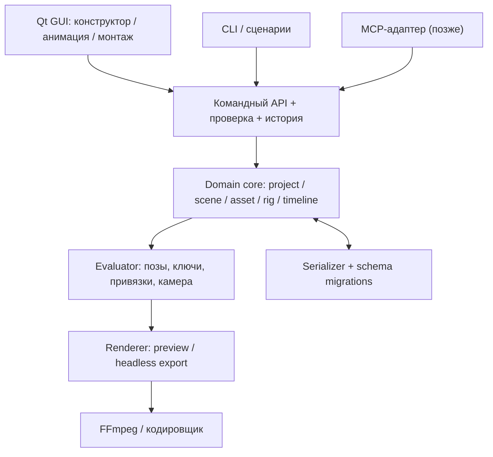

# 06. Техническая архитектура

> Архитектура — **предложение для прототипирования**, не окончательный выбор фреймворка. Приоритет: сначала самостоятельное ядро, затем интерфейс и интеграции.

## Целевая платформа

Первая версия: настольное приложение под **Windows**, офлайн по умолчанию.

Технологическая гипотеза:
- **Python 3.11+** — язык прикладной логики и тестов.
- **PySide6 / Qt 6** — окна, панели, события, визуальная сцена и взаимодействие с объектами.
- **QGraphicsScene / QGraphicsView** — подходящая точка старта для 2D-сцены и масштабируемого интерфейса.
- **JSON + проверяемая схема** — сериализация проектов и отдельных ресурсов.
- **FFmpeg** — кодирование кадров и объединение с аудио по мере развития экспорта.
- **MCP** — необязательный внешний адаптер на последующих этапах.

Официальные справочники:
- [Qt QGraphicsScene](https://doc.qt.io/qt-6/qgraphicsscene.html)
- [Qt QGraphicsView](https://doc.qt.io/qt-6/qgraphicsview.html)
- [Qt for Python (PySide6)](https://doc.qt.io/qtforpython-6/)
- [FFmpeg](https://ffmpeg.org/documentation.html)

## Структура компонентов



**Ни UI, ни MCP не должны напрямую обходить правила изменения проекта.** Это позволяет тестировать операции без открытого графического окна и гарантировать одинаковую семантику ручных и программных правок.

## Модули и ответственность

| Модуль | Назначение |
| --- | --- |
| `domain` | Типы Project, Scene, Layer, Entity, Asset, Rig, Track, Camera |
| `commands` | Операции (добавить объект, изменить позу, вставить кадр), транзакции и undo/redo |
| `validation` | Проверка схемы, ссылок, координат и временных диапазонов |
| `serialization` | Загрузка/сохранение, миграции, импорт/экспорт ресурсов |
| `animation` | Вычисление позы на кадре, FK, позднее IK и интерполяция |
| `rendering` | Отрисовка вычисленной сцены в bitmap/framebuffer |
| `gui` | Qt-виджеты, инструменты мыши, инспектор, таймлайн |
| `export` | Поток кадров, изображения, затем видео/аудио |
| `integrations` | CLI, локальный API, затем MCP |
| `tests` | Модульные, интеграционные и воспроизводимые сценарии |

Названия директорий не обязательны, важны границы ответственности.

## Цикл редактора

```text
Событие GUI / вызов API
    → команда с проверкой параметров
    → транзакция над моделью проекта
    → запись операции для Undo
    → пересчёт кадра на текущем времени
    → обновление только изменившихся графических элементов
    → redraw/preview
```

Экспорт обходит визуальные инструменты GUI:

```text
project + export settings
    → validate
    → for frame in render range: evaluate → draw
    → encoder (FFmpeg, когда подключён)
    → готовый файл
```

## Представление графики

Для раннего UI достаточно сцены Qt и векторных элементов. Но `QGraphicsItem` — **представление**, а не единственный источник данных. Позиция персонажа и свойства сохраняются в доменной модели, а Qt-объекты синхронизируются с ней.

При необходимости более быстрого рендера интерфейс можно заменить, не мигрируя пользовательские файлы.

Для экспорта в первой реализации допустим рендер в изображения, затем кодирование FFmpeg. Нельзя считать рабочую область Qt «снимком готового кадра»: редакторские рамки, сетка, манипуляторы и onion skin не должны попасть в экспорт.

## Операции/Undo

Каждая значимая правка оформлена командой с валидируемыми входными данными. Например:

```text
SetJointRotation(scene_id, entity_id, joint_id, frame, degrees)
MoveEntity(scene_id, entity_id, frame, x, y)
DuplicatePose(scene_id, source_frame, target_frame)
CreateShape(scene_id, layer_id, shape_data)
SetCameraKey(scene_id, frame, center, zoom)
```

Состояние до/после можно хранить как обратимую команду или компактный patch. Групповые операции ИИ и импорта должны быть **атомарны**: либо применяются полностью, либо не применяются совсем.

## Система времени

Проект хранит FPS рациональным числом и кадры целыми индексами. Монтажные клипы в перспективе должны использовать стабильные временные представления и точный пересчёт при разных частотах, чтобы аудио не «уплывало» относительно видео.

## Хранилище

Первый прототип: обычная папка проекта + `project.json`, проверяемая загрузка. Позже: единый архив проекта, превью, резервные копии и управляемый кэш. Системные/абсолютные пути не сериализовать как обязательные ссылки.

## Тестирование

**Модульные:** математика FK/IK, трансформации иерархий, hit-testing логики, интерполяция `hold` и `linear`, управление длительностью, валидация ссылок.

**Round-trip:** `save(load(save(project)))` сохраняет смысл данных, ID и ключи кадров.

**Команды:** undo/redo и атомарные транзакции приводят к ожидаемому состоянию.

**Golden/render:** при одинаковом проекте и настройках рендер изображений соответствует утверждённым эталонам с оговорённой визуальной погрешностью.

**Интеграционные:** короткая сцена → просмотр → экспорт видео → проверка числа кадров, размера и длительности файла.

## Дистрибутив

Позднее изучить portable-версию и установщик Windows; Python-окружение, Qt и FFmpeg нужно упаковать с учётом лицензий и зависимостей. До испытаний прототипа фиксировать конкретный способ сборки преждевременно.

## Архитектурные риски

- Неправильная зависимость данных от Qt усложнит CLI/MCP и автоматические тесты.
- Дублирование каждого кадра приведёт к большим файлам и трудному редактированию.
- Смешивание viewport и camera даст неправильные композиции на экспорте.
- Слишком ранняя сложная физика и полноценный монтаж затормозят достижение первого работающего мультфильма.

**Решение:** сначала вертикальный срез без этих усложнений, затем расширение по обратной связи.
